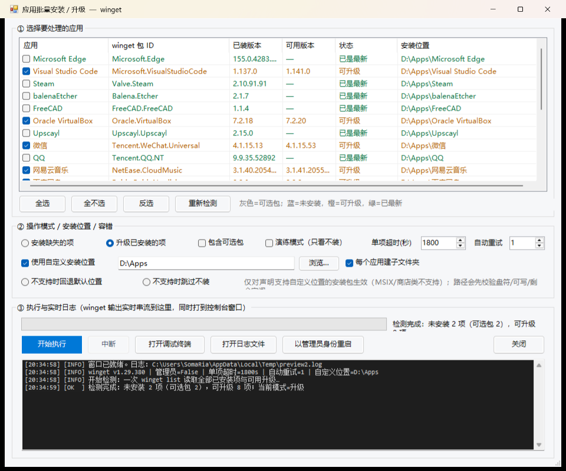

# 应用安装器（Windows · winget 图形界面版）

用 **winget** 批量安装 / 升级常用 Windows 应用。先弹窗勾选、可指定安装路径、有进度条与实时日志，
出错时按原因给出**中文说明 + 处置建议**。



---

## 快速开始

**双击 `安装应用.cmd`**

| 区域 | 说明 |
|---|---|
| ① 选择要处理的应用 | 每行:应用 / winget 包 ID / 已装版本 / 可用版本 / 状态 / **安装位置**。支持全选·全不选·反选·重新检测 |
| ② 操作模式 / 安装位置 / 容错 | 安装缺失项 或 升级已安装项；可选包；演练模式；**单项超时**；**自动重试次数**；**自定义安装位置** |
| ③ 执行与实时日志 | 进度条 + 当前项 + 已用时间；winget 输出实时刷入日志区；开始 / 中断 / 调试终端 / 打开日志 / 提权重启 |

颜色约定:**蓝色 = 未安装**,**橙色 = 可升级**,**绿色 = 已是最新**,**灰色 = 可选包**。

---

## 文件说明

| 文件 | 作用 |
|---|---|
| `安装应用.cmd` | **入口**,双击即启动图形版 |
| `install-apps-gui.ps1` | 图形界面主程序(约 35 KB) |
| `install-desktop-apps.cmd` | 命令行版入口(适合脚本化 / 计划任务) |
| `install-desktop-apps.ps1` | 命令行版主程序 |
| `app-catalog.ps1` | **共享应用清单**(改这里增删应用) |
| `app-lib.ps1` | 公共函数库(winget 调用、版本解析、路径校验等) |
| `docs/使用说明.md` | 完整使用说明(安装路径、异常处置、参数) |
| `docs/界面预览.png` | 界面截图 |

---

## 命令行用法

```powershell
# 演练模式(只检测不安装)
.\install-desktop-apps.cmd -DryRun

# 安装到 D:\Apps
.\install-desktop-apps.cmd -Location D:\Apps

# 只升级指定两项
.\install-desktop-apps.cmd -Upgrade -Only 微信,百度网盘

# 从桌面快捷方式推断要装的应用
.\install-desktop-apps.cmd -FromDesktop
```

---

## 自定义应用清单

编辑 `app-catalog.ps1`,每个应用是一个条目:

```powershell
@{ Name='微信'; Id='Tencent.WeChat'; Optional=$false; Location='D:\Fixed\Apps' }
```

- `Id` 必须是 winget 包 ID(用 `winget search <名字>` 查)
- `Optional=$true` → 界面上显示为灰色,不默认勾选
- `Location` 可单独给某个应用固定安装路径,优先级高于界面上的统一路径

---

## 环境要求

| 项目 | 要求 |
|---|---|
| 系统 | Windows 10 1809+ / Windows 11 |
| PowerShell | 5.1(系统自带)或 7.x |
| winget | App Installer(微软商店应用);缺失时脚本会提示 |
| 权限 | 一般应用普通权限即可;部分安装包需管理员(界面有「以管理员身份重启」) |

---

## 已知限制

- **不是所有安装包都支持自定义路径**(winget `--location` 限制):MSIX / 商店应用不支持,
  部分 EXE/MSI 也不支持 → 界面里可选「回退默认位置」或「跳过不装」
- `--location` 只影响**新安装**;已装应用升级时通常保留原位置
- 需要能访问 winget 源(国内网络可能较慢,可考虑换源)

---

## 许可

MIT License(见 `LICENSE`)

---

## 更新记录

见 [CHANGELOG.md](CHANGELOG.md)
